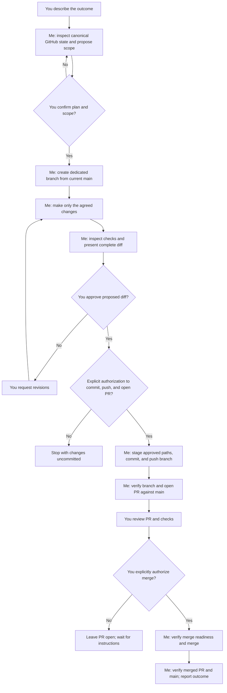

PR-WORKFLOW.md — Step-by-Step Pull Request Workflow
Purpose: a reusable guide to proposing, reviewing, and landing a change through GitHub pull requests. Not a replacement for project-specific AGENTS.md rules or release instructions.

# Pull Request Workflow

This guide describes the workflow used for the flat-SVG cleanup PR. It separates your decisions from the repository work I can prepare. GitHub is canonical; local edits are not a substitute for changes to the repository.

## Roles at a glance

**You:** describe the outcome, confirm the scope, approve the proposed diff, authorize commit/push/PR actions as needed, review the PR, and explicitly authorize merging.

**Me:** inspect the canonical repository, propose a plan, work on a dedicated branch, make only approved changes, show and verify the diff, and perform only the GitHub actions you authorize.

## Step by step

1. **Describe the task — You.** Say what outcome you want. If a request could mean different things, clarify which files or behavior are in scope.
2. **Plan and confirm scope — Me, then you.** I inspect the canonical GitHub state and relevant files, then state the intended paths and actions. I wait for your confirmation before making changes. A general "go ahead" applies to the confirmed scope; it does not authorize unrelated changes.
3. **Create a task branch — Me.** I create or use a dedicated branch based on the current `main`. I verify the branch and base before editing. I do not work directly on `main`.
4. **Make only the agreed changes — Me.** I edit the canonical project files on that branch, preserving unrelated and untracked files. I do not update mirror copies as a substitute for GitHub.
5. **Review and present the diff — Me.** I inspect the changed paths and complete diff, run relevant checks when appropriate, and report limitations. I show you the proposal before committing or opening a PR.
6. **Approve the diff — You.** Review the listed files and changes. Ask for revisions if needed. Your approval to change files is not automatically approval to commit, push, open a PR, or merge unless you explicitly included those actions.
7. **Commit and push — Me, after authorization.** I stage only the approved files, verify the staged diff, commit, and push the task branch. I report the commit and remote branch.
8. **Open the pull request — Me, after authorization.** I check that the branch is present on GitHub, compare it with `main`, check for an existing PR, and open a PR targeting `main`. I report its link and verify its scope.
9. **Review the PR — You.** Inspect the PR on GitHub, including its diff, checks, and any review feedback. Request changes if anything is not right.
10. **Merge — You authorize; I execute only if asked.** I merge only after you explicitly tell me to merge. Before merging, I check that the PR is open and mergeable and note any required checks or reviews. I then verify the merged state and resulting `main` commit. Opening a PR or approving its diff is not permission to merge.
11. **Close the loop — Me.** I report what was completed, the resulting commit or PR, checks run or skipped, and any follow-up required. Publishing a release or deploying is a separate action and requires its own authorization.

## Example: flat-SVG cleanup PR

- You clarified that the scope was exactly the seven `flat-*.svg` files plus the requested rules in `docs/AGENTS.md`; `pieces-flat.svg` was to remain.
- I created a dedicated branch from the current GitHub `main`, deleted those seven files, updated `docs/AGENTS.md`, and showed the diff.
- You approved the diff. I committed the eight changed paths, pushed the branch, and opened PR #2 against `main`.
- You explicitly asked me to merge the PR. I checked that it was open and mergeable, then merged it and verified the new `main` commit.

## Flowchart

